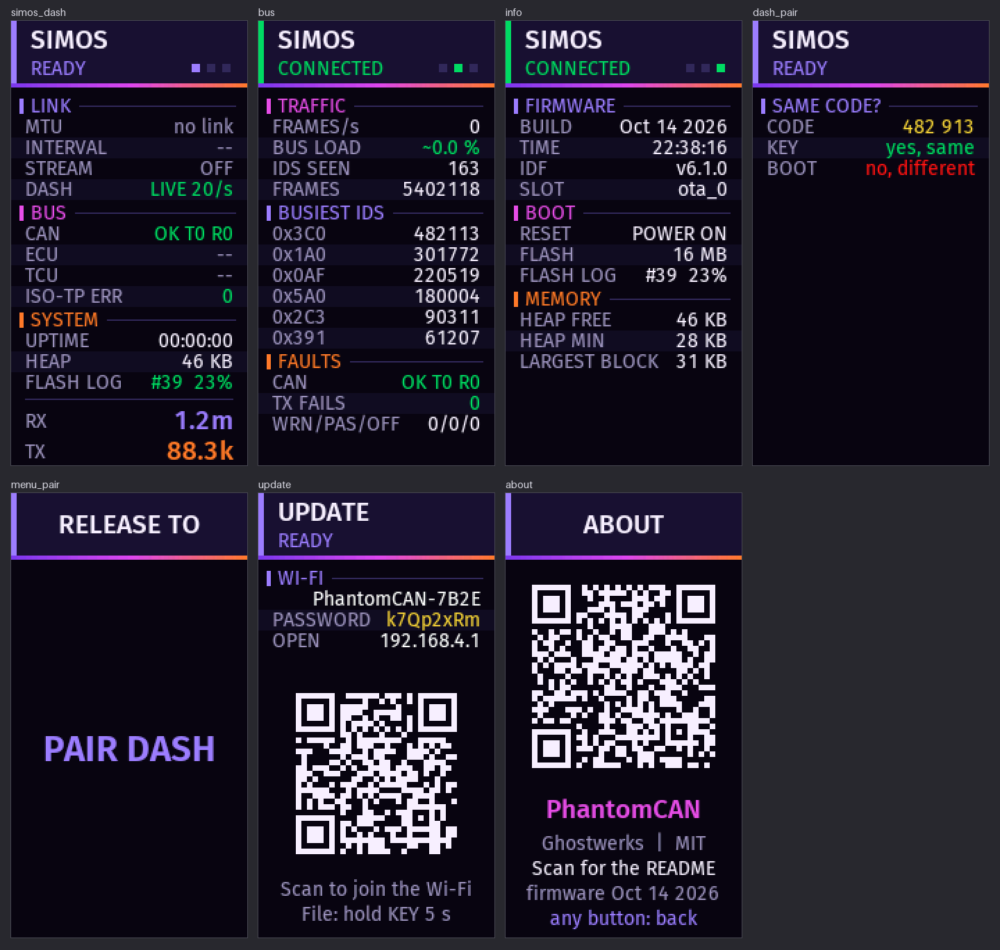

# PhantomCAN

A pocket logging and tuning dongle for VAG cars. It plugs into the OBD-II port, shows what it is doing on its own
screen, and connects to your phone or laptop over Bluetooth, Wi-Fi or USB.

**Status: pre-release.** Your dongle already runs working firmware and does everything below, but it is still being tested and bugs are expected. Features and behaviour can change.

**Firmware updates** will appear in this page's [Releases](../../releases) section; there is no public release yet, so for now the firmware on your dongle is the one to use. Each release will have the update file (`phantomcan-dongle.bin`, installed over Wi-Fi, see [Updating the firmware](#updating-the-firmware)), a full image (only needed to recover a dongle over USB) and a checksum file.

**Known limits** are listed at the end of [How this was built](#how-this-was-built).

**What it does**

* **Log and tune with Simos.app.** A fast Bluetooth link for Simos.app: live ECU and transmission
  logging, ECU info and flashing.
* **Capture CAN traffic on a computer.** SavvyCAN mode streams raw CAN frames over Wi-Fi, so it works with the dongle in the car.
* **Feed an in-car digital dash.** In Simos mode, while no phone app is connected, the dongle sends live readings to the PhantomDASH display over an encrypted radio link; when an app connects the dash pauses and shows **APP CONNECTED**, and it carries on when the app disconnects (the dash is a separate product, still in development).
* **Sleep when the car is off,** and update its own firmware over Wi-Fi.

**Contents:** [What you need](#what-you-need) · [Getting started](#getting-started) · [Choosing a mode](#choosing-a-mode) ·
[Simos mode](#simos-mode) · [SavvyCAN mode](#savvycan-mode) · [The PhantomDASH](#the-phantomdash) ·
[Auto sleep](#auto-sleep) · [Updating the firmware](#updating-the-firmware) · [Troubleshooting](#troubleshooting) ·
[Specifications](#specifications) · [How this was built](#how-this-was-built) · [Safety and legal](#safety-and-legal) ·
[Credits and licences](#credits-and-licences)

---

## What the screen shows



## What you need

* A VAG car (Volkswagen, Audi, SEAT, Skoda) with a standard OBD-II port that uses **CAN at 500 kbit/s**, and that is logged with mode 22. The dongle itself does not care which model it is: what you can log and flash is decided by the app, and **Simos.app** provides the list of supported cars and control units.
* For Simos mode: **Simos.app**, a separate product you get from its own developer. Its developer can tell you which phones and computers it runs on.
* For SavvyCAN mode: a computer with [SavvyCAN](https://www.savvycan.com).

Not supported: CAN FD and DoIP (found on the newest cars), K-line, and older cars that use the TP 2.0 protocol.

## Getting started

1. **Plug the dongle into the OBD-II port,** usually under the dashboard on the driver's side. It starts as soon as it has power.
2. **Turn the ignition on** so the dash lights up. For flashing, use ignition on with the engine off. Some cars need a few seconds after the dash
   lights up before the OBD port wakes.
3. **Wait for the start-up animation (about 3 seconds).** Out of the box the dongle is in Simos mode. The screen then shows **PAIRING MODE** with a **one-minute countdown** and the Bluetooth name, **BLE_TO_ISOTP20**.
4. **Open Simos.app and connect to that name while the countdown runs.** The dongle does not need pairing in your phone's Bluetooth settings; choose it in the app's own device list. If the minute runs out first, the screen says **LOCKED** and the dongle disappears from the app's list: **hold KEY for 2 seconds** to open it for another minute.
5. **Check the screen.** When it works, the header says **CONNECTED** and the **CAN** row shows green **OK**.

To use a different mode (SavvyCAN), or to see what the buttons do, see [Choosing a mode](#choosing-a-mode). If you just let go of the button when you see the screen you want, you will not need the timings.

Do not connect the dongle to a computer over USB while it is plugged into a car. Use Bluetooth or Wi-Fi in the car. USB is for
bench use only.

**The two buttons** are **BOOT** and **KEY**. BOOT changes mode and pages the screen; KEY reopens Bluetooth (2 seconds) and shows the About screen (5 seconds).

**Reading the status screen** (the first page; tap BOOT for the others):

| Row | What it means |
|---|---|
| **MTU, INTERVAL** | The Bluetooth link to your phone: the packet size, and how often the phone and dongle talk (a smaller interval is faster; green is good). **no link** and **--** mean no app is connected. |
| **STREAM** | **ON** with a number means the app is logging and that many readings a second are being sent to it. |
| **DASH** | The link to the PhantomDASH (see [The PhantomDASH](#the-phantomdash)). |
| **CAN** | The car's bus. **OK** is healthy. **T** and **R** count transmit and receive errors on the bus; they should be at or near 0. |
| **ECU, TCU** | How long the engine and transmission computers took to answer the last request, once they have been asked something. |
| **ISO-TP ERR** | Replies that arrived damaged or late. A few over a long session is normal; a number climbing fast is worth telling me about. |
| **HEAP, FLASH LOG** | Memory in use and the dongle's own log. Only useful when you send a bug report. |
| **RX, TX** | Frames received from and sent to the car. |

## Choosing a mode

The dongle has two buttons: **BOOT** and **KEY**. To change mode, hold **BOOT**. You do not need to count seconds: the screen shows what will happen when you let go, so
release when you see what you want. The times below are only a guide.

| Hold BOOT for | The screen offers | What happens |
|---|---|---|
| a quick tap | next page | cycles the status, bus monitor and firmware info pages |
| 2 to 3.5 seconds | the other mode | switches between Simos and SavvyCAN and restarts (in SavvyCAN mode this lasts until 6.5 seconds) |
| about 3.5 to 6.5 seconds (Simos mode) | **Pair dash** | opens a pairing window for the PhantomDASH, no restart (see [The PhantomDASH](#the-phantomdash)) |
| about 6.5 to 8 seconds (about 7 is safe) | **Bench sim** | demo mode, no car needed (see below) |
| about 8 to 9.5 seconds | **Wi-Fi update** | firmware update mode |
| 9.5 seconds or more | **Cancel** | restarts in the same mode |

**Pairing Mode.** After the 3-second start-up animation, Simos and SavvyCAN mode show a **PAIRING MODE** screen with a one-minute
countdown, the Bluetooth name and, where it applies, the Wi-Fi name, password and address. Connect your app while it counts down. It goes away
as soon as something connects, when the minute is up, or when you press any button. In Simos mode Bluetooth stops accepting new
connections when the minute ends (the screen says **LOCKED**); **hold KEY for 2 seconds** to open it, and the Pairing Mode screen, for another minute.
Simos Bluetooth has no password, so its screen shows only the name; the Wi-Fi modes show the Wi-Fi password.
SavvyCAN uses Wi-Fi only, so its screen is a reminder of the network details and nothing locks.

**About screen.** Hold **KEY** for 5 seconds to show a QR code that opens this project's page on
GitHub, along with the product name and firmware build. Any button closes it.

The mode you pick is remembered. Bench sim and Wi-Fi update last for one session only: unplug the dongle and plug it back in to return
to your mode.

**Try it without a car.** Hold BOOT for about 7 seconds and release on **Bench sim**. The dongle then runs your chosen mode against
simulated control units (an engine, a transmission, a gateway and an ABS module), so you can try an
app without a car. Nothing is sent on a car's CAN bus.

## Simos mode

The default mode. The dongle appears over Bluetooth as **BLE_TO_ISOTP20**.

1. Open Simos.app and choose the dongle in its Bluetooth device list.
2. Connect. The screen shows **CONNECTED** with the connection details (link speed and ECU and transmission response times).
3. Use the app as normal: ECU info, logging and flashing.

For flashing, keep the car in ignition on with the engine off, and make sure the car's battery and your phone or laptop are well
charged.

Compatibility notes:

* **Simos.app** works with both the engine control unit (ECU) and the transmission control unit (TCU).

## SavvyCAN mode

For capturing and analysing raw CAN traffic with [SavvyCAN](https://www.savvycan.com) on a computer, with the dongle in the car.

1. Switch the dongle to SavvyCAN mode.
2. On your computer, join the Wi-Fi network **PhantomCAN** (the password is shown on the dongle's screen; it stays the same, so your computer or phone can remember it once).
3. In SavvyCAN, add a new device connection of the **network connection (GVRET)** type, with the IP address `192.168.0.10` and port `23`.
4. Connect. The screen shows the connection status and counts the frames captured and sent.

The dongle reads at 500 kbit/s. Frames you send from SavvyCAN go out on the car's bus, so only send frames you understand.

**What you will see on the car.** Many modern cars (VW, Audi and others) put a gateway module between the OBD-II port and the car's internal
networks. Through the port you normally see only diagnostic traffic: the replies to requests you send, plus a few status messages. Everyday
broadcast data such as RPM or wheel speed is not forwarded, so a capture on a plain OBD-II connection can look nearly empty. To see that
data you either request it from a module by its address, or connect to the car's network behind the gateway.

**Try it without a car.** Power the dongle from any USB port or charger, hold BOOT for about 7 seconds with SavvyCAN as your mode and release on
**Bench sim**, and connect as above over Wi-Fi. SavvyCAN then shows three test messages that repeat (IDs `0x100` every 10 ms, `0x200` every
20 ms and `0x300` every 100 ms), and the simulated control units answer requests: for example, send ID `0x7DF` with the data `02 01 00` and the
engine and transmission reply on `0x7E8` and `0x7E9`.

At a desk you can also connect the dongle to the computer over USB and add it in SavvyCAN as a serial **GVRET** device (250000 baud). Do not do
this while the dongle is in a car.

## The PhantomDASH

For the PhantomDASH digital dash, a separate product that is still in development. There is no separate mode for it: Simos mode serves the dash whenever no phone app is connected. The dongle only reads: it asks the car for the values the dash wants and sends the raw answers over an encrypted ESP-NOW radio link.

* **Pairing, once:** disconnect any phone app, hold **BOOT** until the screen says **PAIR DASH** (about 4 seconds) and let go. Then start pairing on the dash's phone page. Both show the same six-digit code: if they match, confirm on the phone and press **KEY** on the dongle; if not, tap **BOOT**. There is nothing to type, and the keys are kept for next time. With no dash paired, the dongle does not start its radio link at all.
* **Every day:** the dash shows live values as soon as the car is awake. The **DASH** row on the dongle's first page says **LIVE** with the number of reads a second while it is serving the dash.
* **When you connect Simos.app:** the dongle hands the car to the app at once. It switches its dash radio off completely (the app gets the dongle's full memory and attention), and the dash shows **APP CONNECTED**. About 2 seconds after the app disconnects the dash link comes back by itself.
* **Lists:** the dongle carries no value lists. The names, scalings and gauges live on the dash (on its SD card); the dongle only asks the car for the identifiers the dash subscribes to and passes the raw answers back. Mode 22 lists and HSL lists (the engine computer's high-speed logging, which needs a tune with the HSL patch) both work.

## Auto sleep

The OBD-II port has power all the time, so to avoid draining the car's battery the dongle goes into a low-power sleep after **3 minutes**
with no CAN traffic, no connected phone, app or paired dash, and no button presses. Driving the car, unlocking it, connecting an app or pressing BOOT wakes it. If something merely stirred the car's network and nothing
connects, the dongle goes back to sleep after about 30 seconds instead of staying awake for the full 3 minutes. It does
not sleep while connected over USB, or in Bench sim or Wi-Fi update modes. In SavvyCAN mode it sleeps only when no computer is connected.

**Known issue:** in one parked car the dongle stayed awake for hours because the car's network kept sending a status frame. A fix is in the firmware but is not confirmed yet, so do not count on it sleeping.

Sleep lowers the dongle's power use but does not turn it off completely. Idle with no data and the screen off, it draws about **30 to 35 mA** while awake (the 3 minutes before sleep) and about **5 to 6 mA** asleep. That is roughly 0.14 Ah a day asleep, and about 0.8 Ah a day if it stays awake. **If you leave the car parked for more than a day or two, unplug the
dongle.**

## Updating the firmware

You can update over Wi-Fi without any cable.

1. On your phone, download `phantomcan-dongle.bin` from the newest [release](../../releases) first (hold **KEY** for 5 seconds on the dongle for the About screen's QR code that opens this page). The dongle's network has no internet.
2. Hold BOOT for about 8 to 9.5 seconds and release on **Wi-Fi update**.
3. Scan the QR code on the dongle's screen with the phone's camera to join its Wi-Fi, or join by hand: the network shown (**PhantomCAN-** followed by four characters that tell dongles
   apart) and enter the password shown there. The password is new every time.
4. Open `http://192.168.4.1` in a browser (if the phone says "connected without internet", tap the network's **Manage router** or similar link), tap **Choose the update file** and pick `phantomcan-dongle.bin`. The upload starts at once. Compare the file's SHA-256 with the `SHA256SUMS` file in the
   release if you want to check the download.
5. The dongle restarts by itself. **Wait about 30 seconds before unplugging it.** It checks the new firmware as it starts, and goes back to
   the previous version automatically if the new one does not start properly.

## Troubleshooting

| Problem | Try this |
|---|---|
| The dongle does not show in the app | If the screen says **LOCKED**, hold **KEY** for 2 seconds to open Bluetooth for another minute. Also make sure no other phone is connected to it, or unplug it and plug it back in, then look for **BLE_TO_ISOTP20**. |
| Nothing answers, or the screen says BUS SILENT | Turn the ignition on and wait a few seconds. Some cars need the engine running before the OBD port wakes. |
| The app connects but nothing logs | Check the screen says **CONNECTED** and the **CAN** row is green. Make sure the ignition is on. If **ISO-TP ERR** climbs fast, unplug the dongle, plug it back in and reconnect. |
| The screen is dark | It switches off after a while. Press BOOT to wake it. |
| The dongle does not respond after an update | Wait 30 seconds. If it is still unresponsive, unplug it and plug it back in; it starts the previous firmware if the new one failed. |

## Specifications

| | |
|---|---|
| Connection to the car | OBD-II port, CAN at 500 kbit/s (11-bit) |
| Power | 12 V from the OBD-II port. About 75 mA with the screen on and 35 mA with it off, awake and idle; about 6 mA asleep |
| Wireless | Bluetooth LE, a 2.4 GHz Wi-Fi access point (WPA2) and an encrypted ESP-NOW link to the PhantomDASH |
| USB | USB-C, for bench use |
| Display | 1.9 inch colour screen, 170 x 320 |
| Controls | BOOT and KEY buttons |
| Modes | Simos (which also feeds the PhantomDASH) and SavvyCAN, plus Bench sim and Wi-Fi update |
| Protocols | ISO-TP (ISO 15765-2), UDS (ISO 14229), GVRET |

## How this was built

PhantomCAN is made by Ghostwerks. I designed it, I test it, and I am the person to ask about it. The firmware was written with heavy AI
assistance (Claude, from Anthropic, and Gemini, from Google), working from my direction and checked against a real car. I say this plainly because I think you should know. It builds on open-source work, credited below, most of all the
[esp32-isotp-ble-bridge](https://github.com/bri3d/esp32-isotp-ble-bridge) by Brian Ledbetter and Switchleg1.

The dongle keeps a log in its own memory, including crash reports, so a fault can be traced. **Bug reports are welcome:** open an issue on this page (the only support channel for now) and include the log if you can.

**Known limits**

* The hardware is a prototype; a custom board is planned.
* The Bluetooth connection cannot have a password (see Safety and legal).
* Flashing is the newest part. Use it carefully, with the battery charged and the ignition on, engine off.
* In a parked car the dongle may not reach sleep (see Auto sleep).

## Safety and legal

* Anything that writes to a control unit (including flashing) can damage it or void a warranty. Use the dongle on your own vehicle and at your own risk. Keep the battery
  charged and the ignition on, with the engine off, during flashing.
* **Do not connect USB to a computer while the dongle is in the car.**
* The Bluetooth connection cannot have a password (the apps do not support one), so the dongle limits when it accepts connections. In
  Simos mode it takes new Bluetooth connections for **one minute** after it starts and after every button press, then stops
  advertising and the screen shows **LOCKED**. Hold **KEY** for 2 seconds to open it for another minute. While the dongle is plugged into a computer over
  USB (desk use), Bluetooth never locks. An app that is already connected is never cut
  off, and the minute starts again when it disconnects. The Wi-Fi networks use a password, which is shown on the dongle's screen. Unplug the
  dongle when you are not using it.
* Modifying a vehicle's emissions equipment or its emissions-related software can be illegal for road use where you live. This dongle only
  reports what a control unit says; you are responsible for complying with local law.
* Volkswagen, Audi, Golf, GTI, Bluetooth and the other names used here belong to their owners. This product is not affiliated with or
  endorsed by them. PhantomCAN and Ghostwerks are names of this product and its maker. Simos.app is a separate product by its own developer. PhantomCAN is built to be used with it; it is not made, sponsored, endorsed or supported by them.

## Credits and licences

PhantomCAN is made by Ghostwerks. The firmware is provided as ready-to-install files on the [Releases](../../releases) page, for use on PhantomCAN dongles.

It is built on open-source work, used under the licences below, and the authors' notices are kept here as those licences require:

* The Bluetooth and ISO-TP bridge it grew from, [esp32-isotp-ble-bridge](https://github.com/bri3d/esp32-isotp-ble-bridge) by Brian Ledbetter (bri3d), and its
  [fork](https://github.com/Switchleg1/esp32-isotp-ble-bridge) by Switchleg1 (MIT licence).
* [isotp-c](https://github.com/lishen2/isotp-c) by Shen Li (MIT licence).
* [QR Code generator library](https://www.nayuki.io/page/qr-code-generator-library) by Project Nayuki (MIT licence; its notice is kept at the top of `main/qrcodegen.c`), used for the Wi-Fi code on the update screen.
* [Fira Sans](https://github.com/mozilla/Fira) by Mozilla, Telefonica, Carrois Corporate and bBox Type (SIL Open Font License 1.1, notice below), used for all text on the screen.
* [ESP-IDF](https://github.com/espressif/esp-idf) by Espressif Systems and the open-source components it includes, under their own licences
  (mostly Apache 2.0, see [its licence page](https://github.com/espressif/esp-idf/blob/master/LICENSE)).

<details>
<summary>MIT licence notices (esp32-isotp-ble-bridge and isotp-c)</summary>

```
MIT License

Copyright (c) 2021 Brian Ledbetter

Permission is hereby granted, free of charge, to any person obtaining a copy
of this software and associated documentation files (the "Software"), to deal
in the Software without restriction, including without limitation the rights
to use, copy, modify, merge, publish, distribute, sublicense, and/or sell
copies of the Software, and to permit persons to whom the Software is
furnished to do so, subject to the following conditions:

The above copyright notice and this permission notice shall be included in all
copies or substantial portions of the Software.

THE SOFTWARE IS PROVIDED "AS IS", WITHOUT WARRANTY OF ANY KIND, EXPRESS OR
IMPLIED, INCLUDING BUT NOT LIMITED TO THE WARRANTIES OF MERCHANTABILITY,
FITNESS FOR A PARTICULAR PURPOSE AND NONINFRINGEMENT. IN NO EVENT SHALL THE
AUTHORS OR COPYRIGHT HOLDERS BE LIABLE FOR ANY CLAIM, DAMAGES OR OTHER
LIABILITY, WHETHER IN AN ACTION OF CONTRACT, TORT OR OTHERWISE, ARISING FROM,
OUT OF OR IN CONNECTION WITH THE SOFTWARE OR THE USE OR OTHER DEALINGS IN THE
SOFTWARE.

---

isotp-c, https://github.com/lishen2/isotp-c

MIT License

Copyright (c) 2019 Shen Li & Co-Operators

(The permission and warranty text is the same as above.)
```

</details>

<details>
<summary>SIL Open Font License notice (Fira Sans)</summary>

```
Digitized data copyright 2012-2018: The Mozilla Foundation, Telefonica S.A., Carrois Corporate GbR and bBox Type GmbH.

This Font Software is licensed under the SIL Open Font License, Version 1.1.
This license is copied below, and is also available with a FAQ at:
http://scripts.sil.org/OFL

-----------------------------------------------------------
SIL OPEN FONT LICENSE Version 1.1 - 26 February 2007
-----------------------------------------------------------

PREAMBLE
The goals of the Open Font License (OFL) are to stimulate worldwide
development of collaborative font projects, to support the font creation
efforts of academic and linguistic communities, and to provide a free and
open framework in which fonts may be shared and improved in partnership
with others.

The OFL allows the licensed fonts to be used, studied, modified and
redistributed freely as long as they are not sold by themselves. The
fonts, including any derivative works, can be bundled, embedded, 
redistributed and/or sold with any software provided that any reserved
names are not used by derivative works. The fonts and derivatives,
however, cannot be released under any other type of license. The
requirement for fonts to remain under this license does not apply
to any document created using the fonts or their derivatives.

DEFINITIONS
"Font Software" refers to the set of files released by the Copyright
Holder(s) under this license and clearly marked as such. This may
include source files, build scripts and documentation.

"Reserved Font Name" refers to any names specified as such after the
copyright statement(s).

"Original Version" refers to the collection of Font Software components as
distributed by the Copyright Holder(s).

"Modified Version" refers to any derivative made by adding to, deleting,
or substituting -- in part or in whole -- any of the components of the
Original Version, by changing formats or by porting the Font Software to a
new environment.

"Author" refers to any designer, engineer, programmer, technical
writer or other person who contributed to the Font Software.

PERMISSION & CONDITIONS
Permission is hereby granted, free of charge, to any person obtaining
a copy of the Font Software, to use, study, copy, merge, embed, modify,
redistribute, and sell modified and unmodified copies of the Font
Software, subject to the following conditions:

1) Neither the Font Software nor any of its individual components,
in Original or Modified Versions, may be sold by itself.

2) Original or Modified Versions of the Font Software may be bundled,
redistributed and/or sold with any software, provided that each copy
contains the above copyright notice and this license. These can be
included either as stand-alone text files, human-readable headers or
in the appropriate machine-readable metadata fields within text or
binary files as long as those fields can be easily viewed by the user.

3) No Modified Version of the Font Software may use the Reserved Font
Name(s) unless explicit written permission is granted by the corresponding
Copyright Holder. This restriction only applies to the primary font name as
presented to the users.

4) The name(s) of the Copyright Holder(s) or the Author(s) of the Font
Software shall not be used to promote, endorse or advertise any
Modified Version, except to acknowledge the contribution(s) of the
Copyright Holder(s) and the Author(s) or with their explicit written
permission.

5) The Font Software, modified or unmodified, in part or in whole,
must be distributed entirely under this license, and must not be
distributed under any other license. The requirement for fonts to
remain under this license does not apply to any document created
using the Font Software.

TERMINATION
This license becomes null and void if any of the above conditions are
not met.

DISCLAIMER
THE FONT SOFTWARE IS PROVIDED "AS IS", WITHOUT WARRANTY OF ANY KIND,
EXPRESS OR IMPLIED, INCLUDING BUT NOT LIMITED TO ANY WARRANTIES OF
MERCHANTABILITY, FITNESS FOR A PARTICULAR PURPOSE AND NONINFRINGEMENT
OF COPYRIGHT, PATENT, TRADEMARK, OR OTHER RIGHT. IN NO EVENT SHALL THE
COPYRIGHT HOLDER BE LIABLE FOR ANY CLAIM, DAMAGES OR OTHER LIABILITY,
INCLUDING ANY GENERAL, SPECIAL, INDIRECT, INCIDENTAL, OR CONSEQUENTIAL
DAMAGES, WHETHER IN AN ACTION OF CONTRACT, TORT OR OTHERWISE, ARISING
FROM, OUT OF THE USE OR INABILITY TO USE THE FONT SOFTWARE OR FROM
OTHER DEALINGS IN THE FONT SOFTWARE.
```

</details>
